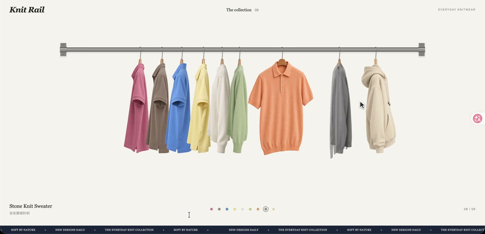

# Knit Rail

一个用原生 HTML、CSS、JavaScript 实现的服饰挂杆交互展示。鼠标悬停时，衣服从侧面转向正面，周围单品自然让位；点击即可查看商品详情。适合服饰作品展示、品牌页面和网站商品陈列。

无需安装依赖或构建，启动本地 HTTP 服务即可体验，也支持通过 iframe 接入现有网站。

## 效果演示

点击下方封面观看悬停交互演示，查看服饰转向、挂杆滑动与惯性摆动效果。

[](assets/demo/preview-hover-operation.mp4)

[▶ 观看演示视频](assets/demo/preview-hover-operation.mp4)

## 快速开始

在项目根目录运行：

```sh
python3 -m http.server 8000
```

浏览器打开 [http://127.0.0.1:8000/](http://127.0.0.1:8000/)。

## 交互与功能

- **自然入场**：服饰依次从挂杆上方落位，衣架与衣服轻轻晃动后自然停稳。
- **悬停展开**：衣服由侧面转向正面，两侧单品沿杆让位，并根据可见边缘自动留出间距。
- **惯性动画**：移动、转向和摆动保留当前速度，快速切换单品时也能平滑衔接。
- **商品详情**：点击单品打开商品卡，支持左右按钮、键盘方向键和手机滑动切换，首尾循环，并记住各件商品的尺码选择；点击关闭按钮或按 Escape 退出。
- **金属挂杆**：原生 WebGL 绘制挂杆与挂钩，处理前后遮挡，挂钩沿杆滑动并保持朝向。
- **移动适配**：支持移动布局，并尊重系统的减少动态效果偏好。

## 维护单品与网站接入

商品数据统一在 `clothes.config.js` 中维护：名称、价格、图片和挂点参数均在同一个条目内。

- 新增单品：在配置数组中添加条目，并填写透明正面、侧面图片路径，默认自动测量边界与挂点。
- 编辑单品：修改对应条目的商品信息或图片路径。
- 隐藏或删除：设置 `enabled: false` 暂时隐藏，或直接删除条目。
- 调整顺序：修改数组中条目的排列顺序。

详细配置示例、素材要求与 iframe 接入步骤见 [INTEGRATION.md](INTEGRATION.md)，接入示例见 [embed-example.html](embed-example.html)。

## 项目结构

| 文件 | 用途 |
| --- | --- |
| `clothes.config.js` | 单品配置，商品数据的唯一来源 |
| `catalog.js` | 配置解析、图片尺寸与透明边界测量 |
| `app.js` | 单品交互、指针事件与商品卡 |
| `motion.js` | 弹簧动画、惯性摆动与服饰间距计算 |
| `hardware.js` | WebGL 金属挂杆与挂钩 |
| `styles.css` | 页面布局、图片转向与商品卡样式 |
| `assets/` | 服饰图片、演示视频、生成提示词与参考素材 |

## 素材与实现说明

当前示例包含 9 件单品。服饰正面与侧面使用两张独立的摄影风格素材，转向通过正交图片平面融合实现，并非完整的服饰三维模型。图片保持等比缩放，原有挂钩区域通过 CSS 裁切，再与独立金属挂钩衔接。

服饰素材由内置 imagegen 生成，提示词保存在 `assets/generation-prompts.md`、`assets/side/generation-prompts.md` 和 `assets/hoodie-generation-prompts.md`。奶油色卫衣及早期金属杆参考图保存在 `assets/references/`；实际运行的金属挂杆由 `hardware.js` 绘制。未设置价格的单品显示“价格待定”。

动画按时间计算，目标改变时保留位置与速度；鼠标穿过单品间的空隙时保持当前布局。服饰间距根据图片不透明区域计算，并计入倾斜占用的宽度，在杆端空间不足时调整布局。

## 回归检查

```sh
node tests/catalog.test.cjs
```

检查单品配置、图片测量与服饰间距。正式演示视频与封面保存在 `assets/demo/`；其余本地预览、录像、系统文件与缓存由 `.gitignore` 排除。

## 赞赏与联系

如果这个项目对你有帮助，欢迎扫码赞赏，给我家小狗加个鸡腿 🍗。感谢你的支持！

如需功能定制或网站接入，欢迎添加微信：**Rambo_Gong**，一起聊聊你的需求。

| 赞赏支持 🍗 | 微信联系 |
| :---: | :---: |
|  |  |
